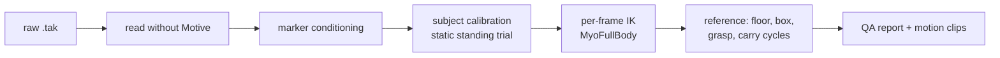

# mocap-to-myofullbody

Turn optical motion-capture recordings (OptiTrack Motive, Plug-in-Gait markers) into motions of **MyoFullBody**, a 416-muscle MuJoCo musculoskeletal model, with checks that show how accurate the result is.

- **Handbook:** https://fitz-yuan.github.io/mocap-to-myofullbody/handbook/ (every stage, the validation, and what it found)
- **Motion viewer:** https://fitz-yuan.github.io/mocap-to-myofullbody/viewer/ (open an exported clip in the browser)

The pipeline was built for a box-lifting study (the MMH Elevator data: subjects pick a 13.6 kg box up from a platform, carry it, and put it on a shelf). The stages are general; the dataset-specific parts are listed under [Adapting to other data](#adapting-to-other-data).

## What it does



1. **Read** OptiTrack `.tak` files directly (`optitrack_tak.py`). A `.tak` is an OLE compound file; the marker trajectories, labels and rigid bodies are parsed from its `Channels.dat` and `Nodes.dat` streams. Checked against Motive's own TRC exports: identical to 0.005 mm on 11 takes.
2. **Condition the markers** (`elev_convert.py`): map labels to Plug-in-Gait (including a subject recorded with the wrong Motive skeleton template), assign the head markers by position, drop mislabelled samples, refill pelvis markers as a rigid body, fit the box pose (Kabsch), find the shelf and floor.
3. **Calibrate each subject** (`mmh_ik.calibrate`): where each marker sits on its bone. With `ELEV_STATIC=1` the subject's static standing trial anchors the joint angles (hips, knees, ankles near 0°); without it the marker placement and the joint angles are not separable and some subjects come out with 20° of knee flexion while standing.
4. **Solve IK per frame** (`mmh_ik.py`, `elev_ik.py`): bounded least squares over 37 degrees of freedom on MyoFullBody, with a robust loss, floor contact, stance-foot locking and joint speed limits.
5. **Build the reference, check it, cut clips** (`elev_build_reference.py`, `elev_qa.py`, `elev_build_dataset.py`, `elev_report.py`).

## Results on the case study

| Check | Result |
|---|---|
| Take reader vs Motive TRC export | identical (max 0.005 mm), 11 takes |
| Marker residual, median per trial | 7.5–12.3 mm (OpenSim IK with the Rajagopal model, S09: about 21 mm) |
| Leave-one-marker-out prediction, median | 14.9 mm |
| Knee angle vs Xsens (S11), shape | r = 0.995 |
| Knee offset vs Xsens, before / after the static-trial calibration | −8 to −10° / +0.7 to −2.4° |
| Quiet-standing knee flexion, median over 22 trials, before / after | 18° / 0° |
| Machine time, 22 trials | about 1 h on 22 CPU cores |

Details, caveats and open items are in the [handbook](https://fitz-yuan.github.io/mocap-to-myofullbody/handbook/).

## Install

```bash
git clone https://github.com/Fitz-Yuan/mocap-to-myofullbody
cd mocap-to-myofullbody
pip install -e ".[tak,xsens]"     # numpy, scipy, mujoco 3.11, olefile, ezc3d
```

The OpenSim baseline (`pipeline/elev_osim_ik.py`) also needs `opensim` from conda (`conda install -c opensim-org opensim`).

## Run

Put the data under one folder (`ELEV_ROOT`, default `~/data/mmh_elevator`):

```
$ELEV_ROOT/
  raw_tak/S<ss>_<Solid|Spring>_NE.tak     trial takes
  raw_tak/static/S<ss>_Anatomy.tak        static standing trials
  meta/anthropometrics.csv                Subject, Height (cm), Weight (kg)
```

Then:

```bash
ELEV_ROOT=~/data/mmh_elevator IK_WORKERS=22 bash pipeline/run_all.sh
```

This writes `tak_cache/`, `npz_tak/`, `ik_tak/` (IK, `qa.json`, `report.json`, `report.md`), `ref_tak/` under `ELEV_ROOT`, and the motion dataset under `data/`.

| Script | Input | Output |
|---|---|---|
| `elev_tak_cache.py` | `raw_tak/*.tak` | `tak_cache/` |
| `elev_convert.py` (`ELEV_SOURCE=tak`) | `tak_cache/`, anthropometrics | `npz_tak/` |
| `elev_ik.py` | `npz_tak/` | `ik_tak/` (offsets, qpos, residuals) |
| `elev_build_reference.py` | IK, `npz_tak/` | `ref_tak/` |
| `elev_qa.py` | IK, refs | `ik_tak/qa.json` |
| `elev_build_dataset.py` | IK, refs | `data/<ELEV_DATA>/` |
| `elev_report.py` | all of the above | `ik_tak/report.json`, `report.md` |

### Validation tools

| Script | What it checks |
|---|---|
| `tak_reader_check.py DIR` | the take reader against Motive's TRC exports |
| `elev_ik_lomo.py` | leave-one-marker-out: solve without a marker, predict it |
| `elev_xsens_compare.py IK_DIR` | knee angles against a simultaneous Xsens recording |
| `elev_static_diag.py` | IK pose of the static trials and bone-length ratios against the model |
| `elev_osim_ik.py` | OpenSim Scale + Marker Placer + IK on the same markers |

## Viewer

```bash
python pipeline/elev_export_viewer.py model OUT_DIR                     # once
python pipeline/elev_export_viewer.py clip S08_Solid_NE OUT_DIR --clip 1  # one carry cycle
#   --ghost-ref-dir OTHER_REF_DIR overlays a second IK run (e.g. another calibration)
```

Open the [viewer](https://fitz-yuan.github.io/mocap-to-myofullbody/viewer/) and drop the `.elvw` clip on it. The file is read in the browser; nothing is uploaded. A clip carries body poses per frame, measured and model markers, joint-angle curves, the QA grades, and two task-neutral lists the viewer draws as given: objects (shape, size, pose) and state tracks (for example hand contact).

## Adapting to other data

A dataset needs:

1. **Labelled marker trajectories** (any format with a reader; `.tak` and TRC are supported). Motive's live labels are enough; unlabelled point clouds are not.
2. **A known marker set**: which bone each marker is on, its weight and a rough anatomical position (`MARKERS` and `_ANAT_L` in `mmh_ik.py` for Plug-in-Gait).
3. **Enough markers per segment** to fix its orientation (ideally three).
4. **A static standing trial per subject**, to anchor the joint angles.
5. **Subject height** (for scaling).

The box, shelf and carry-cycle logic (`elev_build_reference.py`, `elev_build_dataset.py`) is specific to the lifting task.

## Limitations

- MyoFullBody has no knee axial rotation and no neck joint; deep squats reach its 120° joint limits.
- The model is scaled uniformly by height, not per segment.
- Skin markers move on the soft tissue by 1–3 cm in large motions; residuals of about 1 cm are close to that floor.

## Repository layout

```
pipeline/     the scripts (run from the repository root)
mocap2myo/    MyoFullBody model files and small kinematic helpers
docs/         GitHub Pages: landing page, handbook, viewer
```

## License and credits

Code: Apache-2.0 (`LICENSE`). The MyoFullBody model in `mocap2myo/assets/myofullbody/` is by the MuscleMimic team, built upon MyoSuite / MyoSim models (Apache-2.0; see its `LICENSE` and `NOTICE`); the copy here fixes the left knee's coupled rotation (`mocap2myo/model.py`). The viewer uses three.js (MIT). The OpenSim baseline uses the Rajagopal et al. (2016) full-body model (MIT), not included.
