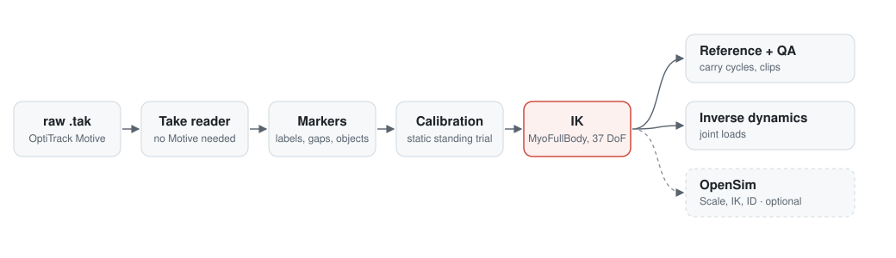

# Mocap to MSK

*Repository: `mocap-to-myofullbody`. Motion capture to musculoskeletal models; MyoFullBody is the default model.*

Turn optical motion-capture recordings (OptiTrack Motive takes, or C3D / TRC files from other labs) into motions of a MuJoCo musculoskeletal model, with checks that show how accurate the result is. The default model is **MyoFullBody** (416 muscles); MyoLeg, MS-Human-700, MASS and OpenSim's Gait2354, Rajagopal 2016 and LaiUhlrich2022 models (converted with MyoConverter) work the same way, and the marker set is data too (Plug-in-Gait and the ISB / Dumas set ship with it). See [Models and marker sets](#models-and-marker-sets).

- **Website:** https://fitz-yuan.github.io/mocap-to-myofullbody/
- **Documentation:** https://fitz-yuan.github.io/mocap-to-myofullbody/documentation/ (every stage, the validation, and what it found)
- **Motion viewer:** https://fitz-yuan.github.io/mocap-to-myofullbody/viewer/ (plays one demo clip; open your own exported clip in the browser)

The pipeline was built for a box-lifting study (the MMH Elevator data: subjects pick a 13.6 kg box up from a platform, carry it, and put it on a shelf). The stages in `pipeline/` and the library in `mocap2myo/` are general; the lifting task (box, shelf, carry cycles) lives in `tasks/box_lift/`, and each dataset's settings (file kind and naming, up axis, subjects' sizes, task) in a profile in `datasets/`. See [Adapting to other data](#adapting-to-other-data).

## What it does

<picture>
  <source media="(prefers-color-scheme: dark)" srcset="docs/assets/pipeline-dark.svg">
  
</picture>

1. **Read** the raw recordings (`pipeline/read_raw.py`): OptiTrack `.tak` files directly (`mocap2myo/tak.py`; a `.tak` is an OLE compound file, the marker trajectories, labels and rigid bodies are parsed from its `Channels.dat` and `Nodes.dat` streams; checked against Motive's own TRC exports: all 11 processed takes identical, largest difference 0.005 mm, float32 rounding), or C3D and TRC files (`mocap2myo/readers.py`, C3D through ezc3d): markers in metres in a Z-up world, the lab software's model outputs kept apart, force plates as the ground reaction on the body per marker frame (force, centre of pressure, free moment, plate corners), other analog channels (EMG) by name, at the recording's own frame rate.
2. **Condition the markers** (`pipeline/prepare_markers.py`): map labels onto the marker set (`mocap2myo/markersets/`: Plug-in-Gait, including a subject labelled with a Motive skeleton template with ISB landmark names; the ISB / Dumas set), assign the head markers by position, drop mislabelled samples, refill pelvis markers as a rigid body. The task adds its objects (`tasks/box_lift/box_fit.py`: box pose by a Kabsch fit, shelf, platform and floor).
3. **Calibrate each subject** (`mocap2myo.ik.calibrate`): where each marker sits on its bone. With `M2M_STATIC=1` (what `run_all.sh` sets; the default in `config.py` is `0`) the subject's static standing trial anchors the joint angles (hips, knees, ankles near 0°); without it the marker placement and the joint angles are not separable and some subjects come out with 20° of knee flexion while standing.
4. **Solve IK per frame** (`mocap2myo/ik.py`, `pipeline/solve_ik.py`): bounded least squares over the model's degrees of freedom (37 on MyoFullBody), with a robust loss, floor contact, stance-foot locking and joint speed limits; the frame-to-frame smoothing is set per second of motion, so a 200 Hz recording gets the same as a 100 Hz one.
5. **Build the reference, check it, cut clips** (`tasks/box_lift/build_reference.py`, `pipeline/qa.py`, `tasks/box_lift/build_dataset.py`, `pipeline/report.py`).
6. **Inverse dynamics** (`mocap2myo/kinetics.py`, `pipeline/kinetics.py`): net joint forces and moments by Newton–Euler on subtrees of the model at the subject's size and mass. The low back (L5/S1), shoulders and elbows come top-down from the body motion and the carried box (no force plates needed); the total ground reaction and its centre of pressure from the whole body; hips, knees and ankles from that reaction shared between the feet (estimated in double support).
7. **Optional OpenSim run** (`run_all.sh --opensim`): the standard Scale + Marker Placer + IK with the Rajagopal 2016 model on the same markers, then OpenSim Inverse Dynamics with the same external loads, scored side by side (`pipeline/validate/opensim_compare.py`, `kinetics_compare.py`).

## Results on the case study

| Check | Result |
|---|---|
| Take reader vs Motive TRC export | identical (max 0.005 mm), 11 processed takes |
| Marker residual, median / 95th pct (22 trials) | 9.2 / 32.7 mm (OpenSim IK on the same markers: 19.8 / 77.3 mm) |
| Quiet-standing knee flexion, median | 0.1° (without the static-trial calibration 18°; OpenSim 10.6°) |
| Low-back (L5/S1) extension moment vs OpenSim Inverse Dynamics, same loads | r = 0.984, RMS difference 13 N·m |
| Shoulder / elbow / hip moments vs OpenSim ID | r = 0.96–0.99 |
| Total vertical ground force vs the lab's force plates | RMS 1.8 % of body weight; box mass recovered from the plates 13.2 kg (nominal 13.6) |
| Machine time, 22 trials | about 1 h on 22 CPU cores (IK); inverse dynamics a few seconds per trial |

Details, caveats and open items are in the [documentation](https://fitz-yuan.github.io/mocap-to-myofullbody/documentation/).

## Install

```bash
git clone https://github.com/Fitz-Yuan/mocap-to-myofullbody
cd mocap-to-myofullbody
pip install -e ".[tak,c3d]"       # numpy, scipy, mujoco 3.11, olefile, ezc3d
```

`olefile` is needed to read `.tak` files, `ezc3d` for C3D files (and the Xsens check). Dataset profiles are TOML, read with the standard library from Python 3.11 (`tomli` on 3.10). The OpenSim baseline (`pipeline/validate/opensim_ik.py`, `pipeline/opensim_id.py`) also needs `opensim` from conda (`conda install -c opensim-org opensim`).

## Run

Run the scripts from the repository root. A dataset is described by a profile (`M2M_DATASET=datasets/<name>.toml`, see [Adapting to other data](#adapting-to-other-data)); without one the settings are the case study's. Put the data under one folder (`M2M_ROOT`, default `~/data/mocap2myo`):

```
$M2M_ROOT/
  raw_tak/S<ss>_<Solid|Spring>_NE.tak     trial takes (M2M_TRIAL_GLOB, default S*_NE)
  raw_tak/static/S<ss>_Anatomy.tak        static standing trials (M2M_STATIC_NAME, default {subject}_Anatomy)
  meta/anthropometrics.csv                Subject, Height (cm), Weight (kg) (M2M_ANTHRO_CSV, M2M_ANTHRO_COLUMNS)
  opensim_setup/                          only for --opensim: Model.osim, markers.xml, a scale setup (see below)
  raw_daq/                                case study only: force-plate recordings (tasks/box_lift/force_plates.py)
```

Then:

```bash
M2M_ROOT=~/data/mocap2myo IK_WORKERS=22 bash pipeline/run_all.sh
# also run the OpenSim workflow on the same data for the comparison (needs opensim from conda;
# OSIM_PY=path/to/that/python if it is another environment)
M2M_ROOT=~/data/mocap2myo IK_WORKERS=22 bash pipeline/run_all.sh --opensim
# another dataset: its profile (here C3D files, see Adapting to other data)
M2M_DATASET=datasets/ramp_vielemeyer2026.toml IK_WORKERS=22 bash pipeline/run_all.sh
```

This writes `tak_cache/` (`raw_cache/` for C3D / TRC), `markers/`, `ik/` (IK, `qa.json`, `report.json`, `report.md`), `ref/` and `kin/` (joint loads, `summary.json`) under `M2M_ROOT`, and the motion dataset under `data/<M2M_DATA>/` of the repository (default `data/box_lift/`). With `--opensim` also `opensim_ik/`, `opensim_id/`, `compare_osim/` and `kin/compare_opensim.md`. Every stage also runs on its own (`python pipeline/<stage>.py --help`); note that `run_all.sh` turns on the static-trial calibration (`M2M_STATIC=1`), which a stage run on its own does not.

| Script | Input | Output |
|---|---|---|
| `pipeline/read_raw.py` | `raw_tak/*.tak` (`M2M_RAW_DIR`; C3D, TRC) | `tak_cache/` (`M2M_CACHE_DIR`) |
| `pipeline/prepare_markers.py` | `tak_cache/`, anthropometrics | `markers/` (`M2M_NPZ_DIR`; with force plates and analog channels from a C3D) |
| `pipeline/solve_ik.py` | `markers/` | `ik/` (`M2M_IK_DIR`: offsets, qpos, residuals, unsolved frames) |
| `tasks/box_lift/build_reference.py` | IK, `markers/` | `ref/` (`M2M_REF_DIR`) |
| `pipeline/qa.py` | IK, `markers/` | `ik/qa.json` |
| `tasks/box_lift/build_dataset.py` | IK, refs | `data/<M2M_DATA>/` |
| `pipeline/report.py` | all of the above | `ik/report.json`, `report.md` |
| `pipeline/kinetics.py` | IK, refs (the task's loads), anthropometrics | `kin/` (`M2M_KIN_DIR`: joint loads per trial, `summary.json`) |
| `pipeline/validate/opensim_ik.py`, `pipeline/opensim_id.py` (`--opensim`) | `markers/`, `kin/`, `opensim_setup/` | `opensim_ik/`, `opensim_id/` |

Every `M2M_*` setting and `IK_WORKERS` is read in `pipeline/config.py`; `MYOFULLBODY_MODEL` and `M2M_MODELS_DIR` belong to the library (`mocap2myo/model.py`, `mocap2myo/profile.py`), and `PY` / `OSIM_PY` to `run_all.sh`. A setting comes from its environment variable, else from the dataset profile (key = the name without `M2M_`, lower case), else the default. Settings with a fixed set of values, and unknown profile keys, stop the run.

| Variable | Default | Meaning |
|---|---|---|
| `M2M_DATASET` | (none) | dataset profile (TOML), e.g. `datasets/ramp_vielemeyer2026.toml` |
| `M2M_ROOT` | `~/data/mocap2myo` | data folder (a relative path in a profile is relative to it) |
| `M2M_INPUT`, `M2M_RAW_DIR`, `M2M_CACHE_DIR` | `tak`, `raw_tak/`, `tak_cache/` | raw file kind (`tak`, `c3d`, `trc`), their folder, `read_raw.py`'s output (`raw_cache/` for C3D / TRC) |
| `M2M_RAW_TRIALS`, `M2M_TRIAL_REGEX`, `M2M_TRIAL_NAME` | `S*_NE.tak`, (none), `{stem}` | trial files (glob under `M2M_RAW_DIR`, `**` allowed); a regex on the path relative to it whose named groups, with `{stem}` (the file name), fill the trial name |
| `M2M_RAW_STATIC`, `M2M_STATIC_REGEX` | `static/*_Anatomy.tak`, `static/(?P<subject>.+)_Anatomy\.tak` | static trial files, and the regex whose group `subject` names the subject |
| `M2M_UP`, `M2M_UNITS`, `M2M_RATE` | `y` (`.tak`) / `auto`, file's, `native` | the files' up axis (`auto`: from head vs foot markers; `x`/`y`/`z`, optionally `-`), length unit, frame rate (a number: keep every k-th frame) |
| `M2M_POINTS_EXCLUDE`, `M2M_ANALOG` | (none), `.*` | C3D: point labels that are not markers (besides the POINT type groups), analog channels to keep (EMG) |
| `M2M_FP_SIGN`, `M2M_FP_MIN_FZ` | `auto`, `20` | C3D force plates: sign of ezc3d's force (`auto`: the vertical force on a loaded plate points up), N below which there is no centre of pressure |
| `M2M_MODEL` | `myofullbody` | the model: a profile in `mocap2myo/profiles/` (see [Models and marker sets](#models-and-marker-sets)) |
| `M2M_MARKER_SET`, `M2M_MARKER_ALIASES` | `plug_in_gait`, `auto` | the marker set the data uses (`mocap2myo/markersets/<name>.toml`); which of its alias label sets a recording may use (`auto`: the best-matching one, if it beats the set's own labels; `none`; or names) |
| `M2M_MODELS_DIR` | `~/data/mocap2myo/models` | where `models/fetch.py` puts the models that are not in the repository |
| `M2M_ANTHRO`, `M2M_ANTHRO_C3D_HEIGHT`, `M2M_ANTHRO_C3D_MASS` | `csv`, `SUBJECT:height`, `SUBJECT:weight` | where heights / masses come from: the CSV, or C3D parameters (`GROUP:NAME`), collected into `<cache>/anthropometrics.csv` |
| `M2M_NPZ_DIR`, `M2M_IK_DIR`, `M2M_REF_DIR` | `markers/`, `ik/`, `ref/` | stage folders under `M2M_ROOT` |
| `M2M_DATA`, `M2M_DATA_STEM` | `box_lift`, `box_lift` | dataset folder in `data/`, file stem `motion_<stem>[_ok]_100hz.npz` |
| `M2M_TASK` | `box_lift` | task package in `tasks/`; `none` = body motion only |
| `M2M_TRIAL_GLOB`, `M2M_SUBJECT_SEP`, `M2M_STATIC_NAME` | `S*_NE`, `_`, `{subject}_Anatomy` | trial names (how every stage finds the trials), subject = trial name up to the first separator, static trial name |
| `M2M_ANTHRO_CSV`, `M2M_ANTHRO_COLUMNS`, `M2M_ANTHRO_SUBJECT` | `meta/anthropometrics.csv`, `Subject,Height,Weight`, `S{:02d}` | subject heights (cm) and masses (kg); how a numeric subject cell maps to the subject in the file names (a cell like `S01` is used as it is) |
| `M2M_STATIC`, `M2M_STATIC_MARKERS`, `M2M_STATIC_SHARE`, `M2M_STATIC_W` | `0` (`run_all.sh`: `1`), `legs`, `0.5`, `1.0` | static-trial calibration: on/off, which markers it places (`legs`, `legs_only`, `all`), its share of the offset update, posture weight |
| `M2M_OUTLIER`, `M2M_ROBUST`, `M2M_LOWPASS_HZ`, `M2M_MTP_PRIOR`, `M2M_ROOT_INIT`, `M2M_PELVIS_GAP`, `M2M_ANCHOR_CENTROID`, `M2M_FOOT_CAP`, `M2M_FLAT_W` | see `config.py` | IK settings (`M2M_ROOT_INIT`: `pelvis` or `prev`; `M2M_PELVIS_GAP`: `solve` or `carry`; `M2M_LOWPASS_HZ` 6, 0 = unfiltered markers) |
| `M2M_NECK` | `0` | `1`: a 3-hinge neck in the IK model so the head follows its markers (MyoFullBody has none); the IK output keeps the model's qpos layout and adds `neck_qpos`; not validated |
| `M2M_IK_FRAMES` | (all) | `a:b`: IK on a frame range only |
| `M2M_LOMO_EVERY_S` | `1.0` | `validate/lomo.py`: one frame per this many seconds |
| `M2M_KIN_DIR`, `M2M_KIN_LOWPASS_HZ` | `kin/`, `6` | inverse-dynamics output; low-pass (Hz) before differentiating positions (also the OpenSim ID's) |
| `M2M_CARRIED_COLUMN`, `M2M_CARRIED_BODY` | `Wgt+K5`, `torso` | a CSV column with the mass while recorded (equipment worn, here a metabolic system); the extra mass is lumped at that body (a body of the model, else that canonical segment's body); ignored when the CSV has no such column |
| `M2M_XSENS_TRIAL`, `M2M_XSENS_C3D` | `S11_Spring_NE`, `xsens_s11/<trial>.c3d` | the Xsens check (`validate/xsens.py`, `opensim_compare.py`) |
| `M2M_OSIM_SETUP_DIR`, `M2M_OSIM_SCALE_SETUP` | `opensim_setup/`, `Sub_09__Scalingsetup_09.xml` | the OpenSim inputs (below) |
| `IK_WORKERS` | 12 | parallel processes of every parallel stage (~1-2 GB each for the IK) |
| `MYOFULLBODY_MODEL` | `kneefix` | `original`: MyoFullBody with the left knee coupling as released (see [License and credits](#license-and-credits)) |
| `PY`, `OSIM_PY` | `python`, `$PY` | `run_all.sh`: the Python for the stages, and the one with `opensim` |

### OpenSim comparison (optional)

`pipeline/validate/opensim_ik.py` needs three files in `opensim_setup/` (`M2M_OSIM_SETUP_DIR`), which are not part of this repository:

- `Model.osim`: the Rajagopal et al. (2016) full-body model ([SimTK](https://simtk.org/projects/full_body)).
- `markers.xml`: an OpenSim MarkerSet for that model with the labels of the marker set in `mocap2myo/markerset.py` (Plug-in-Gait: `LASI`, `RKNE`, `C7`, ...).
- a ScaleTool setup (`M2M_OSIM_SCALE_SETUP`, a file name in that folder or a path): its measurement set (marker pairs per body) defines the scaling, and its Marker Placer task set the marker weights; markers it switches off are switched on at a low weight (`EXTRA_W` in the script). The script sets the model and marker files, the subject's mass and height, and the static trial itself.

### Validation tools

| Script | What it checks |
|---|---|
| `pipeline/validate/tak_reader.py DIR` | the take reader against Motive's TRC exports |
| `pipeline/validate/lomo.py` | leave-one-marker-out: solve without a marker, predict it (writes `ik/lomo.json`, which `report.py` then grades) |
| `pipeline/validate/xsens.py IK_DIR` | knee angles against a simultaneous Xsens recording (`M2M_XSENS_TRIAL`, `M2M_XSENS_C3D`) |
| `pipeline/validate/static_pose.py` | IK pose of the static trials and bone-length ratios against the model |
| `pipeline/validate/opensim_ik.py` | OpenSim Scale + Marker Placer + IK on the same markers |
| `pipeline/validate/opensim_compare.py ["LABEL=IK_DIR" ...]` | our IK runs and the OpenSim run scored with the same checks (the Xsens row only with `ezc3d` and the c3d) |
| `pipeline/validate/kinetics_compare.py` | our joint moments against OpenSim Inverse Dynamics with the same loads |
| `tasks/box_lift/force_plates.py` | the ground reaction against the lab's force plates (case study; plate delay, gain, total force, foot split, box mass) |

## Viewer

```bash
python pipeline/export_viewer.py model OUT_DIR                     # once
python pipeline/export_viewer.py clip S01_Solid_NE OUT_DIR --clip 1  # one carry cycle
#   joint loads and the OpenSim overlay are included when kin/ and opensim_id/ exist
#   --public "Demo 1" writes a de-identified clip for a public page (no trial name, clip
#     position, subject scale or QA grades)
#   --ghost-ref-dir OTHER_REF_DIR [--ghost-label TEXT] overlays a second IK run (e.g. another calibration)
#   --run-label TEXT names the run; --help lists every option
```

Open the [viewer](https://fitz-yuan.github.io/mocap-to-myofullbody/viewer/) (it plays a demo) and drop your `.elvw` clip on it. The plot menu switches between joint angles, joint loads and the ground reaction; the OpenSim button overlays the OpenSim skeleton and its curves (dashed). The file is read in the browser; nothing is uploaded. A clip carries body poses per frame, measured and model markers, joint-angle curves, the QA grades, and two task-neutral lists the viewer draws as given: objects (shape, size, pose) and state tracks (for example hand contact), both from the task (`tasks/box_lift/viewer_scene.py`).

## Models and marker sets

The model and the marker set are both data, so the stages work with any pair of them.

**A model profile** (`mocap2myo/profiles/<name>.toml`, chosen with `M2M_MODEL`) says where the model file is and how to get it, its root and the direction it faces, its neutral standing pose, the joints the IK solves, which of its bodies are the canonical segments (pelvis, torso, head, femur, tibia, foot, toes, scapula, humerus, radius / ulna, hand), its joint centres, the inverse-dynamics joints (and the axes their moments are reported about), its feet and hands. `mocap2myo/landmarks.py` computes some 70 anatomical landmarks from the model's own bones (joint centres; bony points such as the ASIS, the femoral epicondyles, C7, the styloids). Profiles that ship:

| Profile | Model | IK joints | Muscles |
|---|---|---|---|
| `myofullbody` (default) | MyoFullBody, in this repository | 31 + root | 416 |
| `myofullbody_kneeframe` | MyoFullBody with the knee joints at the OpenSim knee's joint frame (opt-in) | 31 + root | 416 |
| `myoleg`, `myoleg_kneeframe` | MyoSim's MyoLeg (legs on a rigid trunk) | 14 + root | 80 |
| `ms_human_700`, `ms_human_700_locomotion` | MS-Human-700, full body / legs | 37 / 14 + root | 700 / 100 |
| `mass` | MASS, converted from its DART files (`models/mass_to_mjcf.py`) | 46 + root | 284 |
| `gait2354`, `rajagopal2016`, `lai_uhlrich2022` | OpenSim models converted with MyoConverter (`models/osim_to_mjcf.py`) | 17 / 23 / 27 + root | 54 / 80 / 80 |

The models other than MyoFullBody are fetched and built once: `M2M_MODELS_DIR=... python models/fetch.py [profile ...]` (the OpenSim conversions need a Python with MyoConverter's dependencies, `--myoconverter-python`); `python models/check.py` prints and draws every profile's landmarks.

**A marker set** (`mocap2myo/markersets/<name>.toml`, chosen with `M2M_MARKER_SET` or the dataset profile's `marker_set`) gives each marker the segment it moves with, the landmark under it, its offset from that landmark in the segment's anatomical axes (anterior, superior, lateral, mm), its weight and its calibration group, and names the roles: head, pelvis, heel / toe and ankle markers, alias label sets. From Plug-in-Gait:

```toml
[markers]
LASI = { segment = "pelvis", landmark = "asis_l", offset_mm = [12, 0, 0], weight = 1.0 }
LKNE = { segment = "femur_l", landmark = "femur_epi_lat_l", offset_mm = [0, 0, 12], weight = 1.0 }
LTHI = { segment = "femur_l", landmark = "hip_l", offset_mm = [0, 0, 70], weight = 0.5, along = ["knee_l", 0.5], group = "loose" }
[roles]
pelvis = ["LASI", "RASI", "LPSI", "RPSI"]
heel = { l = "LHEE", r = "RHEE" }
toe = { l = "LTOE", r = "RTOE" }
```

On MyoFullBody, Plug-in-Gait keeps the hand-tuned marker guesses the case study was calibrated with (the set's `[override]`), so the case-study results are unchanged; on any other model, and for any other set, the markers are placed from the landmarks. Markers on a segment the model lacks (arm markers on MyoLeg), or that no IK joint can move relative to the pelvis, are left out.

## Adapting to other data

A dataset needs:

1. **Labelled marker trajectories**: OptiTrack `.tak` takes, C3D or TRC files (`pipeline/read_raw.py`). Labels as the recording software assigned them are enough; unlabelled point clouds are not. Force plates (C3D) and any frame rate are taken as they are.
2. **A known marker set**: per marker the segment it is on, the anatomical landmark under it and its offset from it, and its weight; a small TOML file in `mocap2myo/markersets/` (format in `mocap2myo/markerset.py`; see [Models and marker sets](#models-and-marker-sets)). The dataset profile names it (`marker_set`, or `M2M_MARKER_SET`).
3. **Enough markers per segment** to fix its orientation (ideally three).
4. **A static standing trial per subject**, to anchor the joint angles.
5. **Subject height** (for scaling).

A dataset's settings go into a profile, a small TOML file in `datasets/` (settings only, no data), loaded with `M2M_DATASET=datasets/<name>.toml`; its keys are the settings of `pipeline/config.py` without `M2M_` (an environment variable still overrides any of them). Three ship with the repository: `mmh_elevator.toml` (the case study; the same as no profile), `ramp_vielemeyer2026.toml` (Vielemeyer et al. 2026, level and ramp walking, Vicon C3D, Plug-in-Gait, 200 Hz, three inclined force plates) and `moissenet2019.toml` (Moissenet and Schreiber 2019, gait at five speeds, Qualisys C3D, the 52-marker ISB / Dumas set `isb_dumas`, height and mass in the C3D). From the ramp profile:

```toml
[paths]
root = "~/data/ramp_vielemeyer2026"     # outputs; relative paths below are under it
raw_dir = "raw"                         # Ref_<n>/<condition>/*.c3d, static_c3d/Ref_<n>/*.c3d
[input]
input = "c3d"
up = "auto"                             # from head vs foot markers (Vicon: z)
points_exclude = '(PEL|HED|TRX|[LR](FE|TI|FO|TO|CL|HU|RA|HN))[OALP]'   # Nexus segment points
[naming]
raw_trials = "Ref_*/*/*.c3d"
trial_regex = 'Ref_\d+/(?P<cond>(level|ramp_\d+)_(up|down))/(?P<subject>Ref\d+)_\w*?shoes(?P<k>\d+)\.c3d'
trial_name = "{subject}_{cond}_{k}"     # Ref_1/level_up/Ref01_sss_le_shoes04.c3d -> Ref01_level_up_04
trial_glob = "Ref*"
raw_static = "static_c3d/*/*.c3d"
static_regex = 'static_c3d/Ref_\d+/(?P<subject>Ref\d+)_(sss_)?le_(sss_)?shoes(_static|01)\.c3d'
static_name = "{subject}_static"
[subjects]
anthro_csv = "anthropometrics.csv"      # Subject, Height (cm), Weight (kg): the article's Table 1
marker_set = "plug_in_gait"
[task]
task = "none"
```

Everything about the lifting task (box template and pose, shelf, platform and floor, carry cycles, the reference, the dataset, the box's load on the hands and the viewer scene) is in `tasks/box_lift/`; another task is another package in `tasks/` with the same hooks (see `tasks/box_lift/__init__.py`), selected with `M2M_TASK`. With `M2M_TASK=none` the pipeline stops at the body motion: IK, QA, report and joint loads with the ground as the only external load; the viewer then reads the IK output (whole trials, no `--clip`).

## Limitations

- MyoFullBody has no knee axial rotation and no neck joint (the IK can add one, `M2M_NECK=1`); deep squats reach its 120° joint limits. Its knee rotates about the tibia's origin, not about the joint frame of the OpenSim model it was converted from (up to 15 mm at the ankle in deep flexion; `myofullbody_kneeframe` corrects it, opt-in).
- The lifting task (`tasks/box_lift/`: reference, dataset, hand contact, box loads) is written for MyoFullBody's bodies; with another model use `M2M_TASK=none`.
- The model is scaled uniformly by height, not per segment.
- Skin markers move on the soft tissue by 1–3 cm in large motions; residuals of about 1 cm are close to that floor.

## Repository layout

```
mocap2myo/           the library
  model.py             MyoFullBody model files (assets/myofullbody/)
  profile.py, profiles/   model profiles: file, root, frame, IK joints, segments, kinetics (TOML)
  landmarks.py         anatomical landmarks from a model's bones (joint centres, bony points)
  markerset.py, markersets/   marker sets as data: segment, landmark, offset, weight per marker
  ik.py                marker model, per-frame IK, subject calibration
  kinetics.py          inverse dynamics: subtree Newton-Euler, ground reaction, foot split
  tak.py               OptiTrack .tak reader, TRC reader / writer
  readers.py           one trial file (C3D, TRC, .tak) -> markers, force plates, analog channels
  kinematics.py, objects.py   joint couplings, sole height, rigid fits; palm spheres
pipeline/            the generic stages (run from the repository root)
  config.py            paths, file naming, settings (the M2M_* environment variables, the profile)
  read_raw.py, prepare_markers.py, solve_ik.py, qa.py, report.py
  kinetics.py          joint loads per trial
  opensim_id.py        OpenSim joint centres and Inverse Dynamics with the same loads (--opensim)
  export_viewer.py, viewer_layers.py   viewer files; plots, force arrows, OpenSim overlay
  run_all.sh           all stages in order
  validate/            tak_reader, lomo, xsens, static_pose, opensim_ik, opensim_compare,
                       kinetics_compare
tasks/box_lift/      the lifting task: __init__.py (the hooks), box_fit.py, checks.py,
                     loads.py, viewer_scene.py, build_reference.py, build_dataset.py,
                     motion_io.py, force_plates.py
datasets/            dataset profiles (TOML): mmh_elevator, ramp_vielemeyer2026, moissenet2019
models/              fetch.py (the other models, pinned), mass_to_mjcf.py, osim_to_mjcf.py,
                     check.py (landmarks, counts and images of every profile)
docs/                GitHub Pages: landing page, documentation (handbook/ redirects there), viewer; assets/ (README images)
```

## License and credits

The code (everything outside `mocap2myo/assets/`) is licensed under Apache-2.0 (`LICENSE`).

The model files in `mocap2myo/assets/myofullbody/` are not covered by that alone. They are MyoFullBody by the MuscleMimic team, built upon MyoSuite / MyoSim models and distributed under Apache-2.0 (`mocap2myo/assets/myofullbody/LICENSE`), with the third-party terms listed in `mocap2myo/assets/myofullbody/NOTICE`. That NOTICE states that the arm and hand parts (from MyoArm / MyoHand) derive from the MoBL-ARMS upper-extremity model, whose licence is BSD 3-Clause with a non-commercial restriction: it was released "solely for non-commercial purposes (including research, academic, evaluation and personal uses)". The full-body model contains those parts, so check that NOTICE before any commercial use; the Apache-2.0 licence of this repository's code does not change it.

Changes made here to the model files: `body/myofullbody_clean.xml` and `body/myofullbody_clean_kneefix.xml` are copies of the released `body/myofullbody.xml` (musclemimic_models 1.0.5) without its scene include (floor and skybox) and with a headlight / offscreen-size block; `leg/assets/myolegs_assets_kneefix.xml` is a copy of `leg/assets/myolegs_assets.xml` with the left knee's coupled rotation / translation fixed (two coefficient sets, which in the released file turned the left shank the wrong way with flexion), and the `kneefix` body file (the default) includes it.

The other models are not in this repository: `models/fetch.py` downloads them at pinned commits and builds them locally (sources, commits and licences in `mocap2myo/profiles/sources.toml`; each profile has a `license` line): MyoLeg (MyoSim, Apache-2.0), MS-Human-700 (Apache-2.0), MASS (Apache-2.0), MyoConverter (Apache-2.0) with OpenSim's Gait2354 (CC BY 3.0), Rajagopal et al. 2016 (MIT Use Agreement) and LaiUhlrich2022 (OpenCap, Apache-2.0).

The viewer uses three.js (MIT). The OpenSim baseline uses the Rajagopal et al. (2016) full-body model (MIT), not included.
