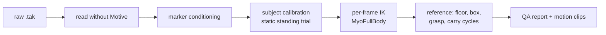

# mocap-to-myofullbody

Turn optical motion-capture recordings (OptiTrack Motive, Plug-in-Gait markers) into motions of **MyoFullBody**, a 416-muscle MuJoCo musculoskeletal model, with checks that show how accurate the result is.

- **Website:** https://fitz-yuan.github.io/mocap-to-myofullbody/
- **Handbook:** https://fitz-yuan.github.io/mocap-to-myofullbody/handbook/ (every stage, the validation, and what it found)
- **Motion viewer:** https://fitz-yuan.github.io/mocap-to-myofullbody/viewer/ (plays demo clips; open your own exported clip in the browser)

The pipeline was built for a box-lifting study (the MMH Elevator data: subjects pick a 13.6 kg box up from a platform, carry it, and put it on a shelf). The stages in `pipeline/` and the library in `mocap2myo/` are general; the lifting task (box, shelf, carry cycles) lives in `tasks/box_lift/`, and the dataset's file naming in `pipeline/config.py`. See [Adapting to other data](#adapting-to-other-data).

## What it does



1. **Read** OptiTrack `.tak` files directly (`mocap2myo/tak.py`, `pipeline/cache_takes.py`). A `.tak` is an OLE compound file; the marker trajectories, labels and rigid bodies are parsed from its `Channels.dat` and `Nodes.dat` streams. Checked against Motive's own TRC exports: identical to 0.005 mm on 11 takes.
2. **Condition the markers** (`pipeline/prepare_markers.py`): map labels onto the marker set (`mocap2myo/markerset.py`: Plug-in-Gait, including a subject recorded with an ISB-named Motive skeleton template), assign the head markers by position, drop mislabelled samples, refill pelvis markers as a rigid body. The task adds its objects (`tasks/box_lift/box_fit.py`: box pose by a Kabsch fit, shelf, platform and floor).
3. **Calibrate each subject** (`mocap2myo.ik.calibrate`): where each marker sits on its bone. With `M2M_STATIC=1` the subject's static standing trial anchors the joint angles (hips, knees, ankles near 0°); without it the marker placement and the joint angles are not separable and some subjects come out with 20° of knee flexion while standing.
4. **Solve IK per frame** (`mocap2myo/ik.py`, `pipeline/solve_ik.py`): bounded least squares over 37 degrees of freedom on MyoFullBody, with a robust loss, floor contact, stance-foot locking and joint speed limits.
5. **Build the reference, check it, cut clips** (`tasks/box_lift/build_reference.py`, `pipeline/qa.py`, `tasks/box_lift/build_dataset.py`, `pipeline/report.py`).

## Results on the case study

| Check | Result |
|---|---|
| Take reader vs Motive TRC export | identical (max 0.005 mm), 11 takes |
| Marker residual, median per trial | 7.5–12.3 mm (OpenSim IK with the Rajagopal model, S09: about 21 mm) |
| Leave-one-marker-out prediction, median | 14.9 mm |
| Knee angle vs Xsens (S11), shape | r = 0.995 |
| Knee offset vs Xsens, before / after the static-trial calibration | −8 to −10° / +0.7 to −2.4° |
| Quiet-standing knee flexion, median over 22 trials, before / after | 18° / 0° |
| Machine time, 22 trials | about 1 h on 22 CPU cores |

Details, caveats and open items are in the [handbook](https://fitz-yuan.github.io/mocap-to-myofullbody/handbook/).

## Install

```bash
git clone https://github.com/Fitz-Yuan/mocap-to-myofullbody
cd mocap-to-myofullbody
pip install -e ".[tak,xsens]"     # numpy, scipy, mujoco 3.11, olefile, ezc3d
```

The OpenSim baseline (`pipeline/validate/opensim_ik.py`) also needs `opensim` from conda (`conda install -c opensim-org opensim`).

## Run

Run the scripts from the repository root. Put the data under one folder (`M2M_ROOT`, default `~/data/mocap2myo`):

```
$M2M_ROOT/
  raw_tak/S<ss>_<Solid|Spring>_NE.tak     trial takes (M2M_TRIAL_GLOB, default S*_NE)
  raw_tak/static/S<ss>_Anatomy.tak        static standing trials (M2M_STATIC_NAME, default {subject}_Anatomy)
  meta/anthropometrics.csv                Subject, Height (cm), Weight (kg) (M2M_ANTHRO_CSV, M2M_ANTHRO_COLUMNS)
```

Then:

```bash
M2M_ROOT=~/data/mocap2myo IK_WORKERS=22 bash pipeline/run_all.sh
```

This writes `tak_cache/`, `markers/`, `ik/` (IK, `qa.json`, `report.json`, `report.md`), `ref/` under `M2M_ROOT`, and the motion dataset under `data/<M2M_DATA>/` (default `data/box_lift/`).

| Script | Input | Output |
|---|---|---|
| `pipeline/cache_takes.py` | `raw_tak/*.tak` | `tak_cache/` |
| `pipeline/prepare_markers.py` (`M2M_SOURCE=tak`) | `tak_cache/`, anthropometrics | `markers/` (`M2M_NPZ_DIR`) |
| `pipeline/solve_ik.py` | `markers/` | `ik/` (`M2M_IK_DIR`: offsets, qpos, residuals) |
| `tasks/box_lift/build_reference.py` | IK, `markers/` | `ref/` (`M2M_REF_DIR`) |
| `pipeline/qa.py` | IK, `markers/` | `ik/qa.json` |
| `tasks/box_lift/build_dataset.py` | IK, refs | `data/<M2M_DATA>/` |
| `pipeline/report.py` | all of the above | `ik/report.json`, `report.md` |

Every path, file-naming rule and environment variable is in `pipeline/config.py`:

| Variable | Default | Meaning |
|---|---|---|
| `M2M_ROOT` | `~/data/mocap2myo` | data folder |
| `M2M_SOURCE` | `export` | `tak`: raw Motive takes (what `run_all.sh` uses); `export`: TRC-as-xlsx exports |
| `M2M_NPZ_DIR`, `M2M_IK_DIR`, `M2M_REF_DIR` | `markers/` (`markers_from_export/` for exports), `ik/`, `ref/` | stage folders under `M2M_ROOT` |
| `M2M_DATA`, `M2M_DATA_STEM` | `box_lift`, `box_lift` | dataset folder in `data/`, file stem `motion_<stem>[_ok]_100hz.npz` |
| `M2M_TASK` | `box_lift` | task package in `tasks/`; `none` = body motion only |
| `M2M_TRIAL_GLOB`, `M2M_SUBJECT_SEP`, `M2M_STATIC_NAME` | `S*_NE`, `_`, `{subject}_Anatomy` | trial names, subject = trial name up to the first separator, static trial name |
| `M2M_ANTHRO_CSV`, `M2M_ANTHRO_COLUMNS`, `M2M_ANTHRO_SUBJECT` | `meta/anthropometrics.csv`, `Subject,Height,Weight`, `S{:02d}` | subject heights (cm) and masses (kg); how the CSV's subject cell maps to the subject in the file names |
| `M2M_STATIC`, `M2M_STATIC_MARKERS`, `M2M_STATIC_SHARE`, `M2M_STATIC_W` | `0` (`run_all.sh`: `1`), `legs`, `0.5`, `1.0` | static-trial calibration: on/off, which markers it places (`legs`, `legs_only`, `all`), its share of the offset update, posture weight |
| `M2M_OUTLIER`, `M2M_ROBUST`, `M2M_LOWPASS_HZ`, `M2M_MTP_PRIOR`, `M2M_ROOT_INIT`, `M2M_PELVIS_GAP`, `M2M_ANCHOR_CENTROID`, `M2M_FOOT_CAP`, `M2M_FLAT_W` | see `config.py` | IK settings |
| `M2M_IK_FRAMES` | (all) | `a:b`: IK on a frame range only |
| `IK_WORKERS` | 12 | parallel processes (~1-2 GB each) |
| `MYOFULLBODY_MODEL` | `kneefix` | `original`: the released model file unchanged |

### Validation tools

| Script | What it checks |
|---|---|
| `pipeline/validate/tak_reader.py DIR` | the take reader against Motive's TRC exports |
| `pipeline/validate/lomo.py` | leave-one-marker-out: solve without a marker, predict it |
| `pipeline/validate/xsens.py IK_DIR` | knee angles against a simultaneous Xsens recording (`M2M_XSENS_TRIAL`, `M2M_XSENS_C3D`) |
| `pipeline/validate/static_pose.py` | IK pose of the static trials and bone-length ratios against the model |
| `pipeline/validate/opensim_ik.py` | OpenSim Scale + Marker Placer + IK on the same markers |
| `pipeline/validate/opensim_compare.py ["LABEL=IK_DIR" ...]` | our IK runs and the OpenSim run scored with the same checks |

## Viewer

```bash
python pipeline/export_viewer.py model OUT_DIR                     # once
python pipeline/export_viewer.py clip S08_Solid_NE OUT_DIR --clip 1  # one carry cycle
#   --ghost-ref-dir OTHER_REF_DIR overlays a second IK run (e.g. another calibration)
```

Open the [viewer](https://fitz-yuan.github.io/mocap-to-myofullbody/viewer/) and drop the `.elvw` clip on it. The file is read in the browser; nothing is uploaded. A clip carries body poses per frame, measured and model markers, joint-angle curves, the QA grades, and two task-neutral lists the viewer draws as given: objects (shape, size, pose) and state tracks (for example hand contact), both from the task (`tasks/box_lift/viewer_scene.py`).

## Adapting to other data

A dataset needs:

1. **Labelled marker trajectories** (any format with a reader; `.tak` and TRC are supported). Motive's live labels are enough; unlabelled point clouds are not.
2. **A known marker set**: which bone each marker is on, its weight and a rough anatomical position. `mocap2myo/markerset.py` defines Plug-in-Gait (`PLUG_IN_GAIT`: markers, anatomical guesses, head / pelvis / foot markers, label aliases); another set is another dict with the same keys, selected with `MARKER_SET`.
3. **Enough markers per segment** to fix its orientation (ideally three).
4. **A static standing trial per subject**, to anchor the joint angles.
5. **Subject height** (for scaling).

File names and folders are set in `pipeline/config.py` (trial glob, how the subject is read from a trial name, the static trial's name, the anthropometrics columns); every setting there can be overridden with its environment variable.

Everything about the lifting task (box template and pose, shelf, platform and floor, carry cycles, the reference, the dataset and the viewer scene) is in `tasks/box_lift/`; another task is another package in `tasks/` with the same hooks (see `tasks/box_lift/__init__.py`), selected with `M2M_TASK`. With `M2M_TASK=none` the pipeline stops at the body motion (IK, QA, report; the viewer then reads the IK output).

## Limitations

- MyoFullBody has no knee axial rotation and no neck joint; deep squats reach its 120° joint limits.
- The model is scaled uniformly by height, not per segment.
- Skin markers move on the soft tissue by 1–3 cm in large motions; residuals of about 1 cm are close to that floor.

## Repository layout

```
mocap2myo/           the library
  model.py             MyoFullBody model files (assets/myofullbody/)
  markerset.py         marker sets (Plug-in-Gait): body, weight, anatomical guess per marker
  ik.py                marker model, per-frame IK, subject calibration
  tak.py               OptiTrack .tak reader, TRC reader / writer
  kinematics.py, objects.py   joint couplings, sole height, hand spheres, lift objects
pipeline/            the generic stages (run from the repository root)
  config.py            paths, file naming, settings (every environment variable)
  cache_takes.py, prepare_markers.py, solve_ik.py, qa.py, report.py, export_viewer.py
  run_all.sh           all stages in order
  validate/            tak_reader, lomo, xsens, static_pose, opensim_ik, opensim_compare
tasks/box_lift/      the lifting task: box_fit.py, checks.py, viewer_scene.py,
                     build_reference.py, build_dataset.py, motion_io.py
docs/                GitHub Pages: landing page, handbook, viewer
```

## License and credits

Code: Apache-2.0 (`LICENSE`). The MyoFullBody model in `mocap2myo/assets/myofullbody/` is by the MuscleMimic team, built upon MyoSuite / MyoSim models (Apache-2.0; see its `LICENSE` and `NOTICE`); the copy here fixes the left knee's coupled rotation (`mocap2myo/model.py`). The viewer uses three.js (MIT). The OpenSim baseline uses the Rajagopal et al. (2016) full-body model (MIT), not included.
